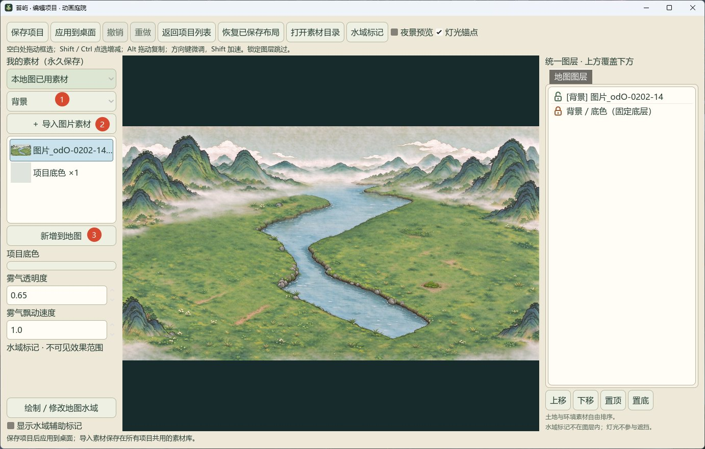
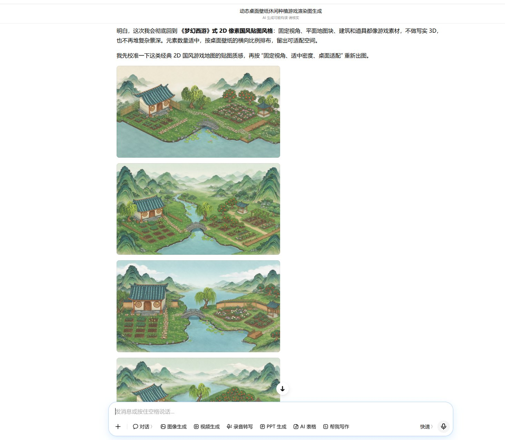
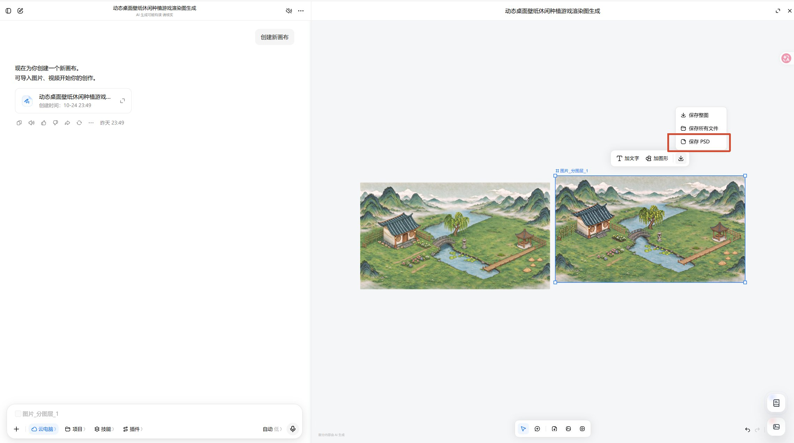
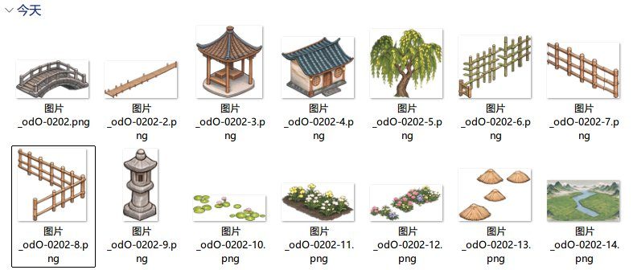

# 苔屿 · Moss Island

**把自己的画，变成可以种植的桌面。**

苔屿是一款 Windows 桌面种植壁纸，使用 Godot 4.6 与原生 Windows 桌面桥接实现。通过分层图片组成 2.5D 场景，在桌面上体验昼夜、天气、风与真实时间的作物生长；内置地图编辑器和作物编辑器，可以从空白开始制作自己的布景。

GitHub：[743567274/moss-island](https://github.com/743567274/moss-island)。项目代码采用 [GPL-3.0-only](LICENSE)。



## 可以做什么

- **原生桌面壁纸**：托盘控制锁定／解锁，解锁后选择田块进行播种、浇水和收获。
- **地图编辑器**：项目管理、分类素材导入、图层排序与锁定、多选移动、复制、旋转、缩放和透明度调整。
- **可配置土地**：普通／选中贴图、自动提亮选中态和交互形状；按自己的画面安排田地大小与位置。
- **环境动画**：树与植被随风摇曳、云层移动；绘制不可见水域标记，限定水面动画与雨滴涟漪范围。
- **昼夜与灯光**：白天／夜间贴图、多个光源锚点、亮度、范围与衰减，以及绘制／擦除受光区域。
- **天气与位置**：晴、阴、雾、分级雨雪及风；自动定位依次尝试系统定位和 IP，失败后可手动选择国内区县，默认北京。实际天气来自网格预报，区县选点不等于站点实测。
- **作物编辑器**：作物与果树类型，12 个视觉状态、贴图缩放、阶段时间、温度、水分与产出配置；作物包可导出。
- **JSON 配置**：内置玉米、棉花、小麦、辣椒、西红柿、烟叶、玫瑰等参考作物；生长参数是简化模拟，受品种和环境影响，见[参数说明](docs/作物参数修订说明-20261026.md)。

## 运行

环境：Windows 10／11 x64、支持 Vulkan 的显卡驱动、.NET Framework 4.8。当前仅面向 Windows 桌面。

获取发布者提供的 Windows 便携包，完整解压，运行 **`MossIsland.exe`**。请保留旁边的 `MossImmersive.exe`、`DesktopBridge.exe` 和 `crops` 等目录。托盘菜单提供解锁桌面、设置、地图编辑器、作物编辑器、仓库和重新获取定位。

存档保存在 `%APPDATA%\Godot\app_userdata\苔屿 · 桌面微观农场`。便携包指程序无需安装；存档仍按 Windows 用户存储。更换电脑要迁移存档时，请退出程序后另行复制用户数据目录。

可在 [Releases](https://github.com/743567274/moss-island/releases) 查看已发布的版本；若暂无发行版，请按下面的步骤从源码构建。请勿把源代码 ZIP 当成可执行便携包。

## 从源码构建

安装 Git、Windows PowerShell，并确保 Windows 的 .NET Framework 编译工具可用。克隆本仓库后在项目根目录执行：

```powershell
git clone https://github.com/743567274/moss-island.git
cd moss-island

# 下载 Godot 4.6 和 Windows 导出模板，编译原生桥接并导出
.\dev\build.ps1 -SkipTests

# 启动编译结果
.\run.ps1
```

首次构建需要联网下载 Godot。输出入口为 `build/MossIsland.exe`；Windows 导出中引擎程序名为 `MossImmersive.exe`。`-SkipTests` 跳过自动测试，不代表构建结果已通过功能验证。开发者需要运行现有检查时，可查看 `dev/test.ps1`；直接省略构建参数也会运行构建脚本指定的检查。

对外发布时打包完整 `build` 文件夹，并附上许可证和第三方声明，见[发布指南](docs/OPEN-SOURCE-RELEASE.md)。不要默认把自己的地图、定位或种植存档带进发行包。

## 用 AI 素材制作自己的桌面

下面是作者实际采用的流程。示例截图中的界面属于当时版本，按钮名称可能随版本变化。豆包用于素材生成／拆分，本程序运行无需豆包。

### 1. 用豆包生成背景

确定统一画风、画幅和视角，预留田地与建筑位置。背景中尽量不要烘焙以后要独立移动的树、云或作物。



### 2. 拆分元素并下载 PSD

使用豆包的 AI 分层功能拆出房屋、树、桥、亭子等元素，并保存 PSD，方便后续调整和补底。



### 3. 导出透明元素

将独立元素导出为透明 PNG。检查边缘白边、残留背景和比例；日夜成对贴图应保持相同画布尺寸与对齐位置。



### 4. 在地图编辑器中拼装

新建空白项目，添加背景，按分类导入透明素材，再放到地图上。素材类型决定程序使用的动画与交互：树／植被受风影响，云层平移，土地可种植；水域通过单独的不可见标记绘制。配置图层、灯光与夜景，保存并应用到桌面。


完整操作见：

- [地图编辑器 HTML 手册](docs/使用手册/地图编辑器使用手册.html)（下载后用浏览器打开）
- [作物编辑器 HTML 手册](docs/使用手册/作物编辑器使用手册.html)
- [地图编辑器说明](docs/MAP-EDITOR.md)
- [作物配置](docs/CROP-PACKAGES.md) · [灯光绘制](docs/LIGHT-PAINTING.md)

## 目录

| 目录 | 内容 |
| --- | --- |
| `scripts/`、`scenes/` | Godot 场景、桌面交互、种植与编辑器 |
| `native/` | Windows 托盘启动器与桌面桥接源码 |
| `assets/` | 图片、图标和着色器 |
| `data/` | 地图、作物与区县数据 |
| `dev/` | 下载、构建与资源处理脚本 |
| `docs/` | 使用手册、架构与素材来源 |

## 许可与素材来源

项目自有代码按 **GNU GPL v3.0 only** 发布，完整条款见 [LICENSE](LICENSE)。第三方组件、地理数据及素材保留各自许可证，见 [第三方声明](docs/THIRD_PARTY.md)。

作者提供的主要背景及新制作素材由**豆包生成**；部分图标、抠图、补底与风格变体由 AI 工具辅助制作。具体范围与授权说明见 [素材声明](ASSETS.md)，历史生成记录保留在各素材清单中。本项目没有提取《梦幻西游》等商业游戏的资源。

早期用于本地参考、未确认再分发许可的 `assets/reference/` 不属于公开源码提交范围。天气 API 有独立的服务使用条款，项目代码的 GPL 许可不会改变外部服务的条款。
